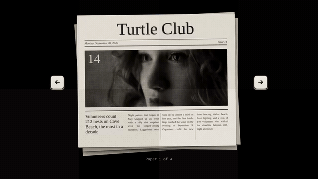
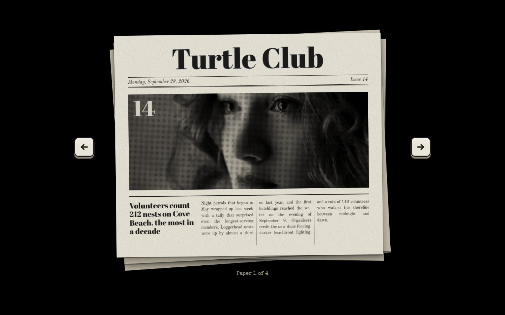
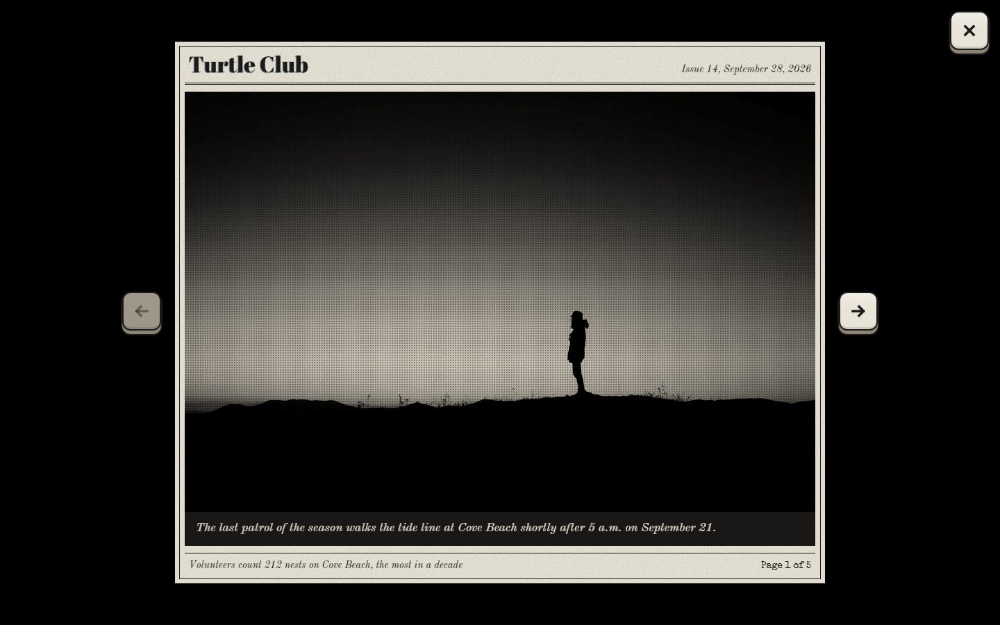
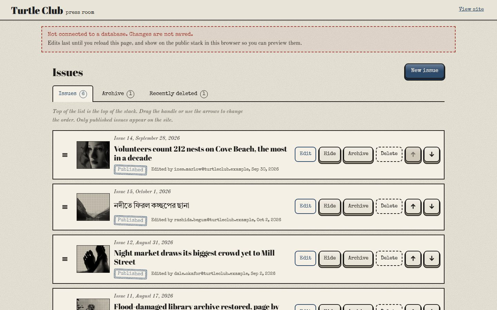
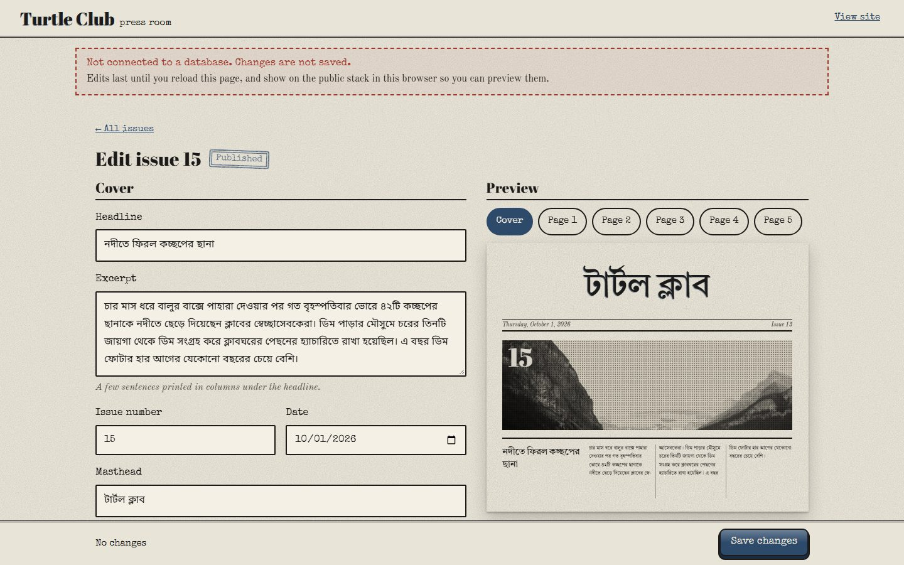
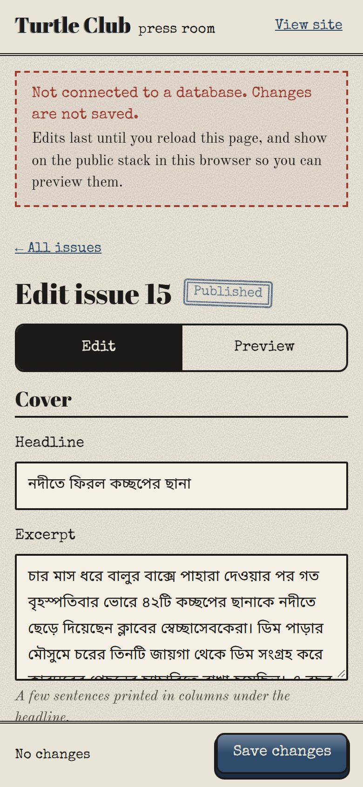

# Turtle Club

A news site that presents each issue as a printed newspaper in a physical stack. Flip through the pile, pick up a paper, and page through the story in a reader.



## 🎬 Demo video

<!-- Drag docs/demo.mp4 here in GitHub's web editor and it will become a playable video -->



## Features

- **The stack.** A pile of newsprint papers on a dark table. Arrow buttons, keyboard arrows or a swipe lift the top paper off by its corner and tuck it under the pile.
- **The reader.** Clicking the top paper opens it into a full newspaper page with a quiet paper page-turn between pages. Photo pages and text pages, with a page counter.
- **Retro print styling.** Halftone photos, paper grain, slight ink misregistration on the masthead, typewriter-key buttons and hand-drawn SVG icons.
- **Bangla and English.** Bangla fonts load only when a story needs them, with line spacing tuned for Bengali script.
- **A built-in CMS.** Editors manage issues and pages from their phone or laptop: rich text (bold, italic, links) that cleans up text pasted from Word, drag-to-reorder, live preview, image upload with in-browser compression, Draft / Published / Hidden / Archived states, and a 30-day Recently deleted bin.
- **Accessible.** Full keyboard support, focus handling in the reader, visible focus styles, and reduced-motion alternatives for every animation.

### The reader



### The CMS







## Built with

React 18, TypeScript, Vite, Framer Motion, React Router, Tiptap, DOMPurify, Supabase (database, auth and storage), CSS Modules.

## Run it locally

```
npm install
npm run dev
```

Then open http://localhost:5173. Without a database configured, the site runs on bundled sample issues, and the CMS opens in a demo mode where changes last until you reload.

## Notes

Sample stories, names and photos are invented for the demo.
